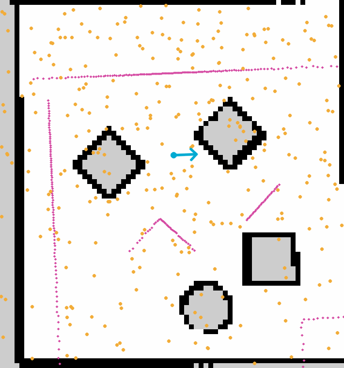
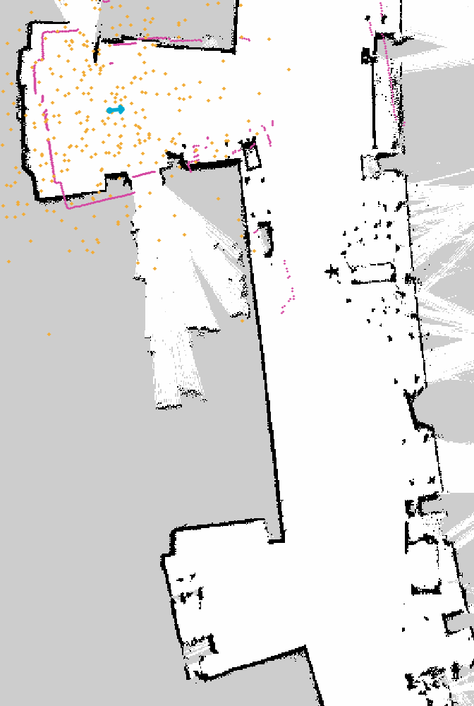
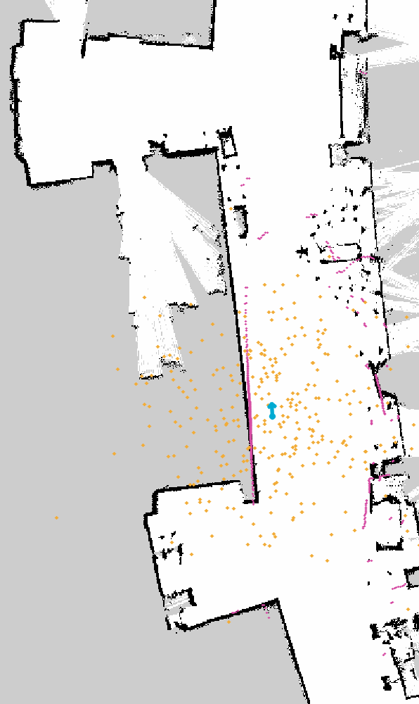

# Commands to run for testing

`ros2 launch neato2_gazebo neato_gauntlet_world.py`

`ros2 launch robot_localization test_pf.py map_yaml:=robot_localization/maps/gauntlet.yaml use_sim_time:=true`

`rviz2 -d robot_localization/rviz/amcl.rviz --ros-args -p use_sim_time:=true`

# Mac run

`ros2 launch robot_localization test_pf.py map_yaml:="./robot_localization/maps/mac_1st_floor_9_23.yaml" use_sim_time:=true`

`IBGL_ALWAYS_SOFTWARE=1 rviz2 -d "./robot_localization/rviz/turtlebot_bag_files.rviz" --ros-args -p use_sim_time:=true`

`ros2 bag play "./robot_localization/bags/macfirst_floor_take_1" --clock --remap /scan:=/stable_scan`

The Mac bag records `/scan`; this remap sends those messages to the filter's `/stable_scan` subscription.

# Robot Localization

Author: Jack, Isa

For Olin ENGR3590 Computational Introduction to Robotics

This README is a comprehensive report that contains both conceptual and
programmatic information regarding implementation details of our robot localization
project. For clarity, the parameters detailed below were from our initial
testing. However, for certain gifs and bag recordings, we modified the parameters to
better show the individual behavior.

## 1. Project Overview

The goal of this project is to learn and practice the implementation of a
specific type of Bayesian filters, particle filters, as well as examining the
effects of many specific design decisions and advanced techniques on the task of
robot localization. This writeup will present details on the overall approach of
our implementation of particle filters, small design adjustments we made on the
algorithm, learnings from debugging, and additional techniques, such as particle injections.

## 2. Particle Filters

Each possible robot pose is represented in our implementation as a Particle, the Particle containing the x-coordinate, y-coordinate, heading, and weight. The ParticleFilter class is in charge of managing these hypotheses, and OccupancyField is responsible for map queries and raycasting. TFHelper deals with coordinate transformations and aligns the lidar timestamps with the odometry.

When the system starts, the particles are chosen around the odometry position and a starting estimate which has been selected in RViz may also be used to initialize the cloud; the possible positions are verified against the map in order to prevent the particles being placed either inside obstacles or outside the map boundaries.

If the robot's movement exceeds either the translation or rotation threshold, the filter takes the measured odometry change and applies it to each particle while also adding some random noise. It then compares ten lidar measurements with the distances that are predicted by raycasting from each particle, and the particles whose predictions match the measurements better are given higher weights.

The filter determines the robot's position by taking a weighted average and its heading by using a circular mean after the weights have been normalized. It carries out resampling whenever the effective sample size drops below half the number of particles or when random particle injection is requested. During resampling, the hypotheses are selected on the basis of their weights and noise is added to ensure diversity.

## 3. Design Decisions

In this section, we document some of the important design decisions we made in our particle filter implementation.

### 3.1 Robot Pose Update Method

One of the last steps of the particle filter sensing loop is to determine the estimated robot pose based on the calculated particle cloud. With all the particles carrying a certain weight representing how likely they are to be the true robot pose, we have the flexibility to experiment with different methods of updating the robot pose. 

When we selected the most significant particle, this caused sudden changes in the displayed pose as another particle became the most likely hypothesis. For this reason, we changed to using a weighted average of the particles' positions and a circular mean of their directions. This method takes into account data from the whole cloud and usually results in a smoother estimate.

The pose calculation itself does not decide which particles survive since resampling is based on the individual particle weights. Instead, the ability to recover from an incorrect hypothesis relies on later measurements, motion noise, and the random injection of particles. A drawback of averaging is that it can result in an estimate lying between separate clusters, possibly even within a wall. Although this was acceptable in our manually controlled demonstration, an autonomous robot would need extra measures to deal with ambiguous estimates.

### 3.2 Robot Kidnapping Problem 

We are interested in exploring the classic robot kidnapping problem in this section, consisting of two parts. 

### 3.2.1 Unknown Initial Position

In this project, the robot never has knowledge of its true initial location. But for the purpose of a global localization algorithm like this particle filter, the robot should be able to estimate where it is in a known map environment eventually over time. Therefore, we designed our algorithm under the constraint of an unknown initial position. 

As stated in Section 3.1, when we used the max weight method to update robot pose, the performance of the localization is hindered significantly by the ambiguity of initial positions. During initialization, the robot is frequently locked onto a random pose at first, and it often can't self-correct itself to produce an estimate closer to the true pose. 

This issue is effectively resolved once we switched the robot pose update strategy to the weighted average approach, where the robot pose won't be locked onto a single pose easily. With this greater tolerance and flexibility in pose estimation, the particle filter algorithm is able to effectively produce an accurate estimate close to the true pose over time. The robot pose can drift and shift drastically within the first few seconds of the simulation when the distribution of the particles is relatively spread out. However, once the filter has taken in enough details of scan data over time, particles quickly collapse into a reasonable estimated pose, effectively overcoming the uncertainty in initial position.

### 3.2.2 Kidnapping Recovery

Another potential issue under the robot kidnapping category is that, when the change of a robot's true pose isn't reflected in the odometry at all for a duration of time, all future estimation will drift and be offset without knowing it. This problem can occur due to unexpected impact from the surroundings, or uncaptured movements due to lossy sensor connections. When the estimation and the reality differ significantly, the robot can start making decisions based on falsely confident pose estimation and encounter undefined behavior.

In the original implementation, the particle filter won't be able to recover from large, sudden shifts in particle estimation because the majority of particles have already converged to be near the true pose. At this point, resampling won't be able to help the robot escape the incorrect pose because there are no other potential particles to try.

To be able to recover from an unexpected offset, the robot needs to first identify it. In our particle filter implementation, when calculating the weight for a particle, it computes a likelihood value first based on how well the theoretical raycasting matches with the actual lidar scan. We can store this likelihood value for every particle, and take the mean of them. If the mean likelihood value is below a certain threshold, the algorithm can claim that the robot is kidnapped with a large offset. 

Once identified, we will intentionally inject by overwriting a fraction of the current particles to be completely randomly distributed across the entire map. This alone allows the algorithm to have enough possibility to catch onto another single particle that is closer to the new true pose. As more data and update cycles go by, this single particle will gather more and more weights until it is enough to correct the pose estimation.


## 4. Challenges & Future Improvements
It was difficult to work with lidar measurements since they could not be properly compared with the distances predicted by the map. The filter now rejects any measurements that are non-finite and also removes those which are outside the sensor's stated range. The distances which are predicted are restricted to the maximum range of the scan. Yet presently the raycaster looks as far as 10 m by default, and this still amounts to a limitation when it comes to longer readings.

A further difficulty was the generation of particles inside obstacles or outside the map. Free-space checks were introduced both during initialization and resampling. When invalid candidates are obtained, they are retried; and during resampling the original chosen pose is kept if no valid perturbed position can be found. However, initialization still has a limitation in that if repeated sampling fails to generate sufficient valid particles, its particle-count assertion may fail.

Coordinate frames were also a major source of error; when an odometry displacement was applied directly to particles that had different headings, incorrect predictions resulted. In order to deal with this, we converted the displacement from the odometry frame into the robot frame and then rotated it into the map frame using each particle's heading.

One way to improve the approach is to select recovery particles from a probability field based on a map rather than choosing them uniformly throughout all free space. This type of field could focus on areas where the predicted sensor readings match those in the current scan. Unlike our present method of weighted resampling, which draws from the particles that already exist, this approach would suggest new hypotheses for regions not currently covered by the cloud. We should check whether or not it leads to a reduction in recovery time without ruling out plausible locations.

## 5. Lessons Learned
This project demonstrated that coordinate-frame errors are able to take control of the behaviour of a filter that is in other respects reasonable. When we examined each transformation separately and put them into helper functions, the prediction stage became simpler to understand and to debug.

The fact that we separated map operations into OccupancyField also enabled us to test weighting on its own. By using mocked raycasts we were able to verify whether better agreement between the measurements led to higher particle weights without having to run the entire robot system.

The intermediate values that were published together with RViz proved useful in detecting instances when particles moved incorrectly or lost agreement with the lidar data, and we also realised that we should check the raw sensor readings and their limits before concluding that the unexpected behaviour was due to the filter.

## 6. Recorded Bag Details
We evaluated the particle filter using three recorded datasets: a kidnapping recovery test in the Gauntlet environment and two recordings from the first floor of the MAC building.

The visualizations show the map, particle cloud in gold, lidar readings in pink, and estimated robot pose in cyan. All GIFs play at 4× speed.

### 6.1 Kidnapping Recovery
- __Bag:__ `bags/pf_with_kidnap_recovery`
- __Map:__ `maps/gauntlet.yaml`
- __Length:__ ~2 minutes

This recording shows the recovery of a robot after being kidnapped. It showcases how the robot detects the particles no longer matching the lidar projections, and responds by adding a random set of particles to the map as "scouts" for new positions. After a number of sensor updates, the particle cloud reconcentrates on the new location.



### 6.2 MAC First Floor: Take 1
- __Bag:__ `bags/macfirst_floor_take_1`
- __Map:__ `maps/mac_1st_floor_9_23.yaml`
- __Length:__ ~1.5 minutes
This recording demonstrates the particle filter in the MAC hallway. The particle cloud starts dispersed but quickly converges after a number of sensor updates.



### 6.3 MAC First Floor: Take 2
- __Bag:__ `bags/macfirst_floor_take_2`
- __Map:__ `maps/mac_1st_floor_9_23.yaml`
- __Length:__ 45 seconds

This demo shows the particle filter failing mid-run and triggering a rehome event. The filter then incorrectly localizes the robot for ~5 seconds until the filter fixes itself and refocuses on the true robot position.


### 6.4 Replaying the Bags

Run these commands from the directory containing the robot_localization package, after building and sourcing the workspace. Start the filter with the matching map and simulated time enabled, and open RViz using the configurations listed above.

__Gauntlet Recording:__

`ros2 bag play "./robot_localization/bags/pf_with_kidnap_recovery" --clock`

The MAC recordings publish /scan, while the filter subscribes to /stable_scan, so playback requires a topic remap:

```
ros2 bag play "./robot_localization/bags/macfirst_floor_take_1" \
  --clock --remap /scan:=/stable_scan

ros2 bag play "./robot_localization/bags/macfirst_floor_take_2" \
  --clock --remap /scan:=/stable_scan
```

## 7. Unit Tests

Run the following commands from the robot_localization package directory. This command uses the local python environment.

```
source /opt/ros/jazzy/setup.bash
.venv/bin/python -m unittest discover -s . -p unit_tests.py -v
```

All five unit tests passed. They check particle initialization, laser-based weighting, weight normalization, invalid-weight handling, and resampling. Map queries and publishing are mocked so the tests do not require a running robot or map server.

```
Ran 5 tests in 0.005s

OK
```
